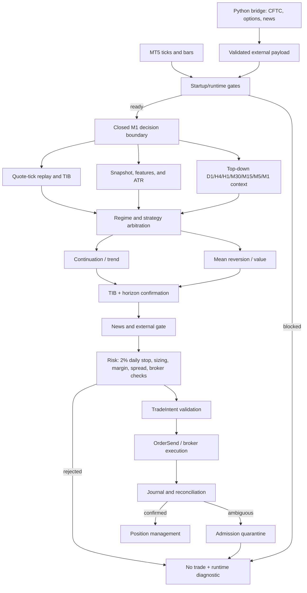

# THE-VAULT / AlgoMind

The Vault is the collaboration home for AlgoMind and its AMIGO XAUUSD system. The verified rebuild is in `AMIGO_REBUILD_DELIVERY_20261120/`.

## Start here

- `Amigo/` — lightweight Python package entry points.
- `MQL5/` — MT5 expert, includes, scripts, and broker-facing execution code.
- `Python/` — research, bridge, data, feature, risk, and tests.
- `research/` — experiments, protocols, datasets, and quantitative evidence.
- `Docs/` — specifications, engineering decisions, audits, and handover notes.
- `reports/` — generated result summaries.
- `schemas/` — contracts shared across MQL5 and Python.
- `config/` — reproducible configuration files.
- `data/` — local/external data references; never commit credentials.
- `scratch/` — disposable investigations, not production authority.

## Authority boundary

MQL5 is the final authority for order submission, hard risk, position management, and transaction reconciliation. Python may provide research and validated external context, but it must not bypass MQL5 safety gates.

## AMIGO system wiring

The external bridge is disabled during tester/optimization runs to prevent look-ahead data.
