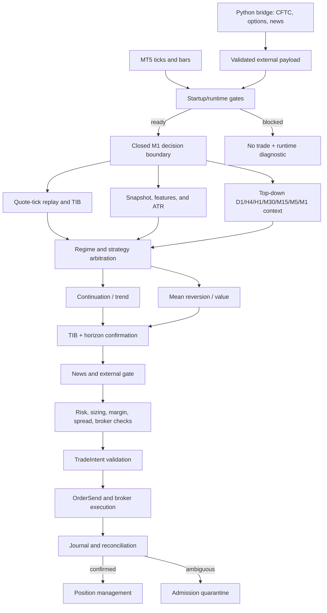

# THE-VAULT / AlgoMind

The Vault is the collaboration home for AlgoMind and its AMIGO XAUUSD system.

## Start here

- `Amigo/` — small Python package entry points.
- `MQL5/` — MT5 expert, includes, scripts, and broker-facing execution code.
- `Python/` — research, bridge, data, feature, risk, and test code.
- `research/` — experiments, protocols, datasets, and quantitative evidence.
- `Docs/` — specifications, engineering decisions, audits, and handover notes.
- `reports/` — generated result summaries.
- `schemas/` — contracts shared across MQL5 and Python.
- `config/` — reproducible configuration files.
- `data/` — local or externally sourced data references; do not commit private credentials.
- `scratch/` — disposable investigations; not production authority.

## Authority boundary

MQL5 is the final authority for order submission, hard risk, position management, and transaction reconciliation. Python may provide research and validated external context, but it must not bypass MQL5 safety gates.

## Collaboration rules

1. Work on a topic branch; keep `main` release-ready.
2. Use a pull request for changes to MQL5, risk, bridge, schemas, or research claims.
3. Keep generated logs and scratch output out of production folders.
4. Every quantitative claim must name its data period, costs, sample size, and whether it is native MT5 or offline.
5. Never commit API keys, account credentials, broker tokens, or private tick archives.

## AMIGO flow

