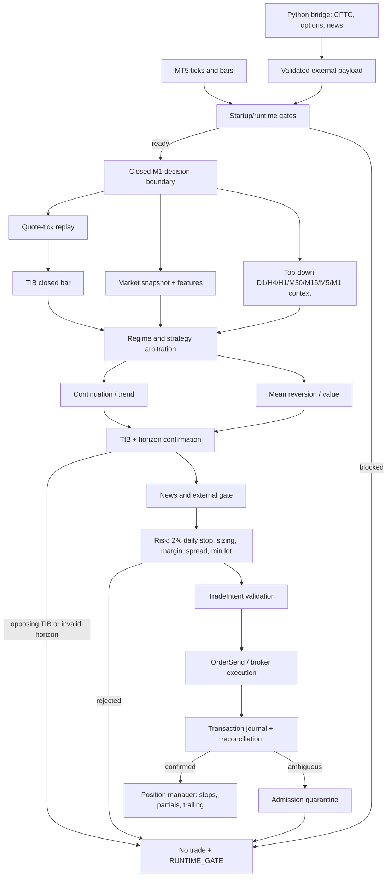

# AlgoMind / AMIGO

AMIGO is the MQL5-first XAUUSD decision and execution system. The verified rebuild is in `AMIGO_REBUILD_DELIVERY_20261120/`.

## AMIGO system wiring

MQL5 remains the execution and hard-risk authority. The external bridge is disabled during tester/optimization runs to prevent look-ahead data.
